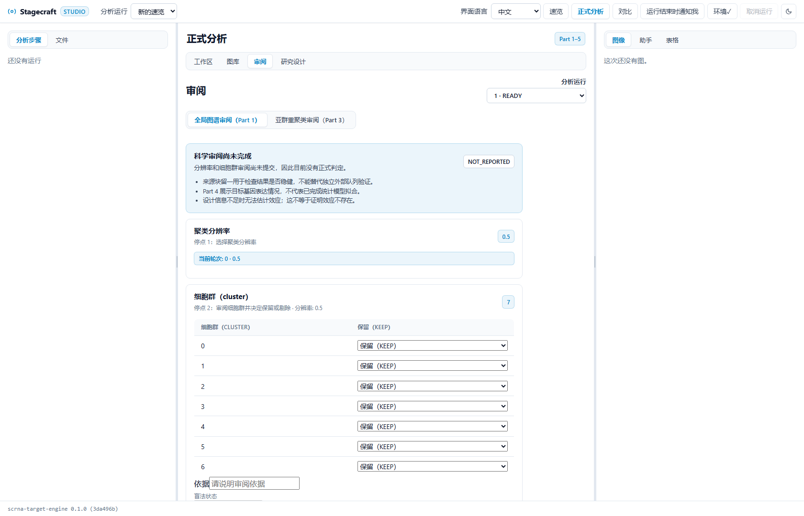
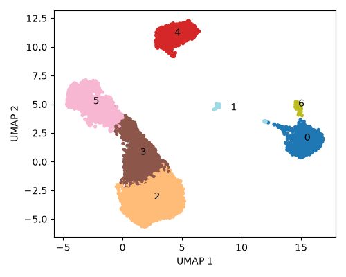
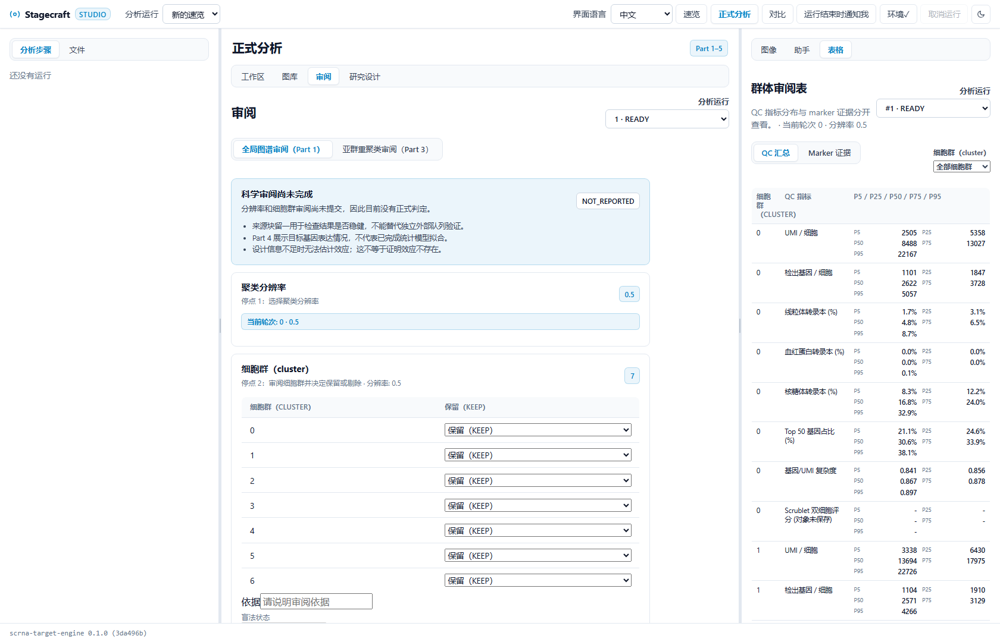

<div align="center">

# Stagecraft Studio

**从单细胞速览到可追溯的正式分析。**

为研究者设计的本地单细胞 RNA-seq 工作台：运行固定分析流程，审阅每个群体与证据，再决定哪些结果可以进入下游。

[English](#english) · [功能](#功能) · [快速开始](#快速开始) · [许可](#license)

[](LICENSE)
[](https://www.python.org/)
[](#使用前请知悉)

</div>

## Studio 一览

界面把运行参数、图像、逐群 QC、marker 证据和人工审阅放在同一工作区。科学决定仍由研究者提交；可选 AI 助手只读取获准的摘要，并将建议保留为草案。



<p align="center"><sub>真实运行界面。示例运行尚未提交细胞群去留决定；截图中的表单默认值不是分析结论。</sub></p>

## 示例结果

以下图像来自公开 GEO 数据集的真实试跑：3 个 GEO 系列的 16 个 library，抽样并经 QC 后共 13,408 个细胞。Harmony 按数据集整合；图中为 Leiden resolution 0.5 的 UMAP，共 7 个群。它用于展示分析产物与审阅材料，不代表已完成人工群体命名或外部验证。

来源：[GSE233275](https://www.ncbi.nlm.nih.gov/geo/query/acc.cgi?acc=GSE233275)、[GSE272294](https://www.ncbi.nlm.nih.gov/geo/query/acc.cgi?acc=GSE272294)、[GSE280401](https://www.ncbi.nlm.nih.gov/geo/query/acc.cgi?acc=GSE280401)。



<details>
<summary>查看逐群 QC 汇总表示例</summary>

QC 表按群体展示 UMI、检出基因数、线粒体与其他转录本比例、复杂度及其 P5/P25/P50/P75/P95。Marker 证据另表逐基因列出，便于人工比较。



</details>

## 功能

- **快速速览**：固定的 Scanpy 流程、图像预览、分页表格和复现包；明确标为细胞水平探索结果。
- **Part 1 图谱审阅**：从每个 library 的 QC、严格共同基因合并到 resolution 网格；人工决定 cluster 去留，删除后从保留的 raw counts 重算，稳定后再命名和锁定。
- **Part 2–5 正式分析**：围绕锁定图谱生成描述性结果、可识别性检查和供体层面模型；设计不足时保留 NOT_ESTIMABLE，不会把缺少信息说成没有效应。
- **证据与审计**：协议冻结、审阅记录、规则检查、产物 hash 和结果图集保存在本地项目中。
- **双语界面与可选 AI 助手**：支持中文/English；助手不自动冻结协议、提交审阅或改写科学状态。

## 快速开始

当前提供 Windows 双击启动脚本。首次运行会同步三个组件的 Python 依赖、构建页面并打开浏览器。

1. 安装 [uv 0.9.2](https://docs.astral.sh/uv/getting-started/installation/)、[Node.js 24](https://nodejs.org/) 和 Git；随后运行 npm install -g pnpm@12.8.1。
2. 将三个仓库放在同一个文件夹中，目录名称保持如下：

   ```text
   your-folder/
     stagecraft-studio/
     scrna-target-engine/
     stagecraft-formal-engine/
   ```

   - [Studio](https://github.com/Guoming-Lynn/stagecraft-studio)
   - [速览引擎](https://github.com/Guoming-Lynn/scrna-target-engine)
   - [正式分析引擎](https://github.com/Guoming-Lynn/stagecraft-formal-engine)

3. 双击 stagecraft-studio/Start Studio.cmd。保持启动窗口打开；关闭窗口会停止本地服务。

正式引擎仓库目前尚未上传源码，完整正式分析暂不可从 GitHub 安装。速览引擎可单独配合 Studio 使用。正式分析还需要 R、R 包 jsonlite、Matrix，以及模型对应的 limma、edgeR 或 DESeq2。安装说明和命令行选项见 [docs/install.md](docs/install.md)。

## 使用前请知悉

这是供早期试用的研究软件，不是临床诊断工具。当前公开版本尚未完成跨平台安装验收，也没有用真实研究数据在 GUI 中走完 Part 1–5 全流程。建议先使用公开数据，并由熟悉单细胞分析的研究者核查 QC、聚类和统计设计。

Studio 默认只在本机回环地址提供服务；速览富集读取本地 GMT，不会把基因列表发送到在线服务。只有在你明确确认发送摘要后，AI 助手才会把授权摘要发往配置的模型服务。目标基因盲审、校准边界和“留一来源块不等于独立复制”等限制仍由后端规则约束。

## 开发与测试

```powershell
uv sync --frozen
uv run pytest
uv run ruff check .
uv run mypy
uv run python scripts/check_hygiene.py
pnpm install --frozen-lockfile
pnpm -C web lint
pnpm -C web typecheck
pnpm -C web test
pnpm -C web e2e
```

## English

Stagecraft Studio is a local workbench for single-cell RNA-seq, from quick exploratory analysis to protocol-frozen, evidence-tracked workflows. Researchers retain control over cluster review and downstream decisions. The optional AI assistant works from authorized summaries and produces drafts only.

The screenshots show a real run on public GEO data: 16 libraries from three series, with 13,408 cells after sampling and QC. The UMAP shows Leiden resolution 0.5 with seven clusters. Cluster labels and review decisions have not been submitted.

This is an early-access research tool. The full Part 1–5 GUI workflow and clean-machine installation have not yet been validated end to end. See [Quick Start](#快速开始), [Usage Notes](#使用前请知悉), and [Installation Details](docs/install.md).

## License

GPL-3.0-only. See [LICENSE](LICENSE).
